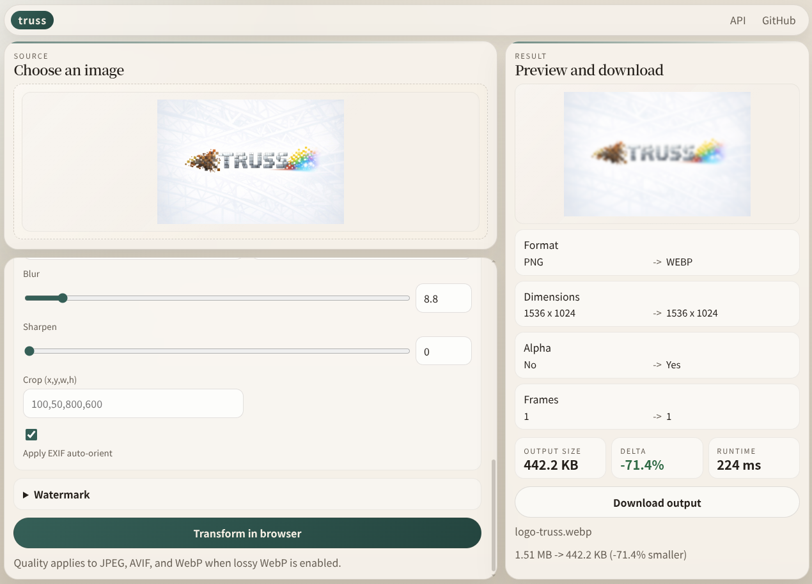
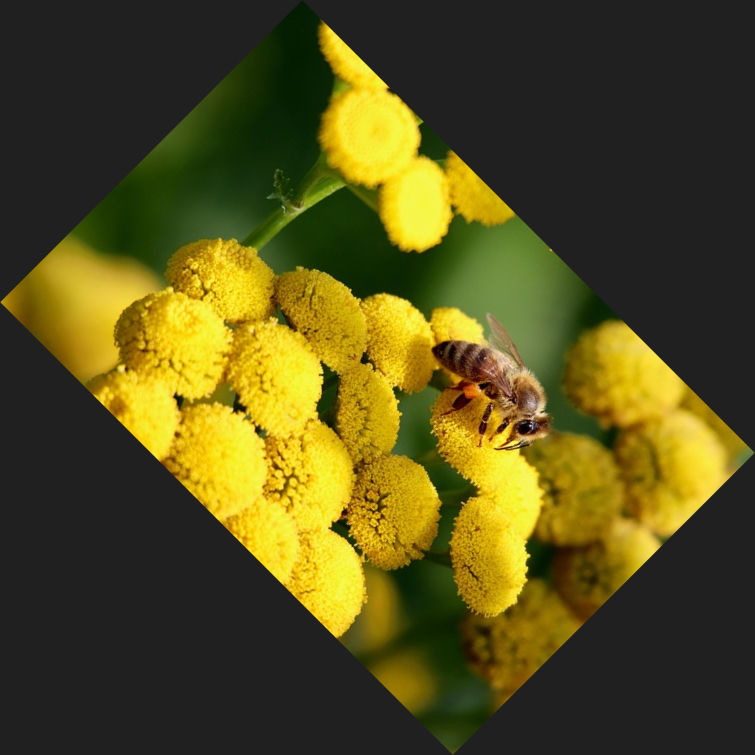
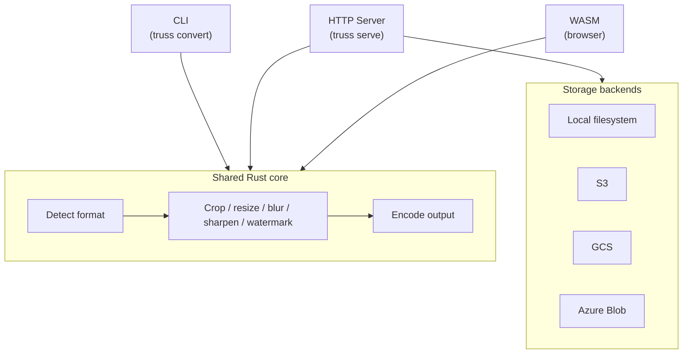

# truss

<!-- ALL-CONTRIBUTORS-BADGE:START - Do not remove or modify this section -->
[](#contributors)
<!-- ALL-CONTRIBUTORS-BADGE:END -->
[](https://github.com/nao1215/truss/actions/workflows/rust.yml)
[](https://github.com/nao1215/truss/actions/workflows/integration-cli.yml)
[](https://github.com/nao1215/truss/actions/workflows/integration.yml)
[](https://github.com/nao1215/truss/actions/workflows/gitleaks.yml)
[](https://github.com/nao1215/truss/actions/workflows/trivy.yml)
[](https://github.com/nao1215/truss/actions/workflows/cargo-deny.yml)
[](https://github.com/nao1215/atago)
[](https://github.com/nao1215/himorime)
[](https://crates.io/crates/truss-image)
[](https://crates.io/crates/truss-image)
[](https://github.com/nao1215/truss/releases)
[](./LICENSE)
[](https://scorecard.dev/viewer/?uri=github.com/nao1215/truss)
[](Cargo.toml)


truss is an image transformation tool with a shared Rust core for a CLI, an HTTP server, and a browser/WASM build.

[Try the WASM demo in your browser](https://nao1215.github.io/truss/). It runs entirely client-side, so nothing is uploaded.



## Start here

| If you want to... | Start with | Read next |
|-------------------|------------|-----------|
| Convert local files from the shell | `brew install nao1215/tap/truss` or `cargo install truss-image`, then `truss photo.png -o photo.jpg` | [CLI](#cli), [Commands](#commands) |
| Run an HTTP image server | `TRUSS_BEARER_TOKEN=changeme truss serve --bind 0.0.0.0:8080 --storage-root ./images` | [HTTP server](#http-server), [API Reference](docs/api-reference.md), [Deployment Guide](docs/deployment.md) |
| Process files in a browser app | `npm install @nao1215/truss-wasm` | [WASM](#wasm), [WASM Integration](docs/wasm.md) |
| Generate signed public URLs from Node.js | `npm install @nao1215/truss-url-signer` | [TypeScript URL signing](#typescript-url-signing), [Signed URL Specification](docs/signed-url-spec.md) |

truss reads and writes JPEG, PNG, WebP, BMP, TIFF, and SVG, and reads GIF. It does not support AVIF. Signed URLs, SSRF protections, and SVG sanitization are built in. It runs on Linux, macOS, and Windows; [atago](https://github.com/nao1215/atago) tests the CLI and [runn](https://github.com/k1LoW/runn) tests the HTTP API.

## Installation

### CLI

#### Homebrew

```sh
brew install nao1215/tap/truss
```

#### Arch Linux (AUR)

```sh
yay -S truss-bin   # or: paru -S truss-bin
```

[`truss-bin`](https://aur.archlinux.org/packages/truss-bin) is community-maintained and installs the release binary.

#### Cargo

```sh
cargo install truss-image
```

For S3, GCS, or Azure storage backends, see [installing with storage backend support](docs/deployment.md#installing-with-storage-backend-support).

Prebuilt binaries are on the [GitHub Releases](https://github.com/nao1215/truss/releases) page, each with a `release-manifest.json` for download scripts. The [Deployment Guide](docs/deployment.md) lists all targets, the Docker images, and the [manifest fields](docs/deployment.md#downloading-release-binaries-from-a-program).

#### Verifying a release

From v0.26.0 on, `checksums.txt` is signed with cosign, the release carries SLSA provenance, and the container image is signed by digest. The license texts of every crate in the binaries are attached as `truss-<tag>-THIRD_PARTY_LICENSES.html` and are in the image at `/usr/share/doc/truss/THIRD_PARTY_LICENSES.html`. With the files of one release (`<tag>` such as `v0.26.0`) in the current directory:

```sh
sha256sum --ignore-missing --check checksums.txt
cosign verify-blob --bundle checksums.txt.sigstore.json \
  --certificate-identity "https://github.com/nao1215/truss/.github/workflows/release.yml@refs/tags/<tag>" \
  --certificate-oidc-issuer https://token.actions.githubusercontent.com \
  checksums.txt
slsa-verifier verify-artifact <archive> --provenance-path truss-<tag>.intoto.jsonl \
  --source-uri github.com/nao1215/truss --source-tag <tag>
gh attestation verify <archive> --repo nao1215/truss
cosign verify ghcr.io/nao1215/truss:<version> \
  --certificate-identity "https://github.com/nao1215/truss/.github/workflows/release.yml@refs/tags/<tag>" \
  --certificate-oidc-issuer https://token.actions.githubusercontent.com
```

### JavaScript packages

```sh
# Browser/WASM package
npm install @nao1215/truss-wasm

# Node.js URL signer
npm install @nao1215/truss-url-signer
```

The sources and READMEs are in [`packages/truss-wasm`](./packages/truss-wasm) and [`packages/truss-url-signer`](./packages/truss-url-signer).

### Container image

```sh
docker pull ghcr.io/nao1215/truss:latest
```

## Quick start

### CLI

`truss photo.png -o photo.jpg` is short for `truss convert photo.png -o photo.jpg`. Run `truss convert --help` for every option.

```sh
# Convert format
truss photo.png -o photo.jpg

# Resize + convert
truss photo.png -o thumb.webp --width 800 --format webp --quality 75

# Optimize in place with the shared pipeline
truss optimize photo.jpg -o photo-optimized.jpg --mode auto

# Convert from a remote URL
truss --url https://example.com/img.png -o out.webp --format webp

# Sanitize SVG (remove scripts and external references)
truss diagram.svg -o safe.svg

# Inspect metadata
truss inspect photo.jpg
```

`inspect` reports the stored size (`width`, `height`) and the size `convert` produces (`orientedWidth`, `orientedHeight`). They differ when an EXIF orientation swaps the axes, as in a portrait phone photo:

```console
$ truss inspect portrait.jpg
{
  "format": "jpeg",
  "mime": "image/jpeg",
  "width": 4032,
  "height": 3024,
  "orientation": 6,
  "orientedWidth": 3024,
  "orientedHeight": 4032,
  "hasAlpha": false,
  "isAnimated": false
}
```

#### Format conversion and quality

The output format comes from the file extension, or from `--format`.

AVIF is rejected as input and as `--format avif`, because the AVIF decoder truss used is licensed AGPL-3.0 or commercially, which an MIT tool cannot ship. Convert AVIF with another tool first, and use WebP for compressed output.

| Format | File size (640 x 427) | Notes |
|--------|----------------------:|-------|
| JPEG (original) | 80 KB | Lossy, widely supported |
| WebP (`--quality 80`) | 38 KB | ~52 % smaller than JPEG |
| PNG | 480 KB | Lossless |

```sh
# JPEG -> WebP (smaller file, same visual quality)
truss photo.jpg -o photo.webp --quality 80

# Explicit format override (ignore extension)
truss photo.jpg -o output.bin --format png
```

`--quality <1-100>` sets lossy encoding quality. `--optimize auto|lossless|lossy` on `convert`, or `truss optimize`, picks format-aware encoder settings to shrink the output; `--target-quality ssim:0.98` or `--target-quality psnr:42` makes lossy optimization aim for that threshold.

| Quality 90 (95 KB) | Original (80 KB) | Quality 30 (27 KB) |
|---|---|---|
|  |  |  |

#### GIF input

truss reads GIF but never writes it. `--format gif` is rejected, and a GIF input with no other format hint becomes PNG.

```sh
# Convert a GIF to PNG, keeping the palette colors and any transparent index
truss photo.gif -o photo.png

# Any transform works the same as for other raster inputs
truss photo.gif -o thumb.webp --width 320 --format webp

# Check whether an upload is animated before converting it
truss inspect upload.gif
```

An animated GIF, WebP, or APNG is refused instead of being cut to its first frame:

```sh
$ truss convert animated.gif -o out.png
error: animated gif is not supported (3 frames); truss transforms single-frame images only
$ echo $?
3
```

`truss inspect` reads them and reports `"isAnimated": true`, so a pipeline can check before converting.

#### Resize and fit modes

Specify `--width` and/or `--height` to resize. When both are given, `--fit` controls how the image fits the target box:

| Mode | Output size | Behavior |
|------|-------------|----------|
| `contain` (default) | exactly the box | Scale to fit inside the box, preserving aspect ratio, then pad the remainder with `--background`. |
| `cover` | exactly the box | Scale to fill the box, preserving aspect ratio, then crop the excess. Use `--position` to choose the crop anchor. |
| `fill` | exactly the box | Stretch each axis to the box, ignoring aspect ratio. |
| `inside` | at most the box | Scale to fit inside the box, preserving aspect ratio, and add no padding. Usually smaller than the box on one axis. |

`contain` and `inside` scale the same way: a 640 x 427 photo bounded by 300 x 300 becomes 300 x 200, then `contain` pads it to 300 x 300 and `inside` stops there.

| Original (640 x 427) | contain 300 x 300 | cover 300 x 300 | fill 300 x 300 | inside 300 x 300 |
|---|---|---|---|---|
|  |  |  |  |  |

```sh
# contain -- fit inside the box, pad with gray background
truss photo.jpg -o out.jpg --width 300 --height 300 --fit contain --background CCCCCC

# cover -- fill the box, crop the excess
truss photo.jpg -o out.jpg --width 300 --height 300 --fit cover

# fill -- stretch to exact dimensions
truss photo.jpg -o out.jpg --width 300 --height 300 --fit fill

# inside -- bound the image by the box without padding it
truss photo.jpg -o out.jpg --width 300 --height 300 --fit inside

# Width only -- height is calculated to preserve aspect ratio
truss photo.jpg -o out.jpg --width 800
```

#### Never enlarging a small image

Without `--without-enlargement`, a source smaller than the requested size is scaled up. The flag works with any `--fit` and with a single-axis resize:

```sh
# The everyday "max 800x600, leave small images alone" resize
truss photo.jpg -o out.jpg --width 800 --height 600 --fit inside --without-enlargement

# Contain still pads out to the full box; only the content stops growing
truss photo.jpg -o out.jpg --width 800 --height 600 --fit contain --without-enlargement

# Works on a single axis too
truss photo.jpg -o out.jpg --width 800 --without-enlargement
```

#### Cover position

When using `--fit cover`, `--position` controls which part of the image is kept:

| `--position top-left` | `--position center` (default) | `--position bottom-right` |
|---|---|---|
|  |  |  |

Available positions: `center`, `top`, `right`, `bottom`, `left`, `top-left`, `top-right`, `bottom-left`, `bottom-right`.

```sh
truss photo.jpg -o thumb.jpg --width 300 --height 300 --fit cover --position top-left
```

#### Crop, rotate, and background

```sh
# Crop a region (x, y, width, height) -- applied before resize
truss photo.jpg -o cropped.jpg --crop 100,50,400,300

# Rotate clockwise by any whole number of degrees
truss photo.jpg -o rotated.jpg --rotate 270

# Negative turns counter-clockwise, and angles past a full turn wrap:
# these three are the same rotation
truss photo.jpg -o a.jpg --rotate 270
truss photo.jpg -o b.jpg --rotate -90
truss photo.jpg -o c.jpg --rotate 630

# An angle that is not a multiple of 90 grows the canvas to fit the whole image,
# and fills the exposed corners with --background
truss photo.jpg -o tilted.jpg --rotate 45 --background 202020

# Background color as RRGGBB or RRGGBBAA hex (useful with contain or PNG alpha)
truss photo.jpg -o out.png --width 300 --height 300 --fit contain --background FF6B35FF
```

| Original | Crop (`--crop 100,50,400,300`) | Rotate (`--rotate 270`) | Rotate (`--rotate 45`) | Background (`--background FF6B35FF`) |
|---|---|---|---|---|
|  |  |  |  |  |

Multiples of 90 are lossless. Other angles resample bilinearly into the rotated bounding box, and the exposed corners take `--background` (default: transparent with alpha, white without).

#### Blur, sharpen, and watermark

| Original | Gaussian Blur (`--blur 5.0`) | Sharpen (`--sharpen 3.0`) | Watermark |
|---|---|---|---|
|  |  |  |  |

```sh
# Gaussian blur (sigma 0.1 - 100.0)
truss photo.jpg -o blurred.jpg --blur 5.0

# Sharpen (sigma 0.1 - 100.0)
truss photo.jpg -o sharpened.jpg --sharpen 3.0

# Watermark with full control
truss photo.jpg -o watermarked.jpg \
  --watermark logo.png \
  --watermark-position bottom-right \
  --watermark-opacity 50 \
  --watermark-margin 10
```

Watermark positions are the same as cover positions. The overlay must be a raster image; the picture under it may be an SVG, which is rasterized first (see [the pipeline](docs/pipeline.md#svg-path)).

#### Grayscale

| Original | Grayscale (`--grayscale`) |
|---|---|
|  |  |

```sh
# Desaturate to grayscale
truss photo.jpg -o gray.jpg --grayscale

# Combine with other operations
truss photo.jpg -o thumb.jpg --width 320 --grayscale
```

Luminance uses the Rec. 601 weights and alpha is kept. Desaturation runs after resize, blur, and sharpen and before the watermark, so the watermark keeps its colors and `--fit contain --background ff0000 --grayscale` gives gray padding. With SVG input it works when the output is raster, and is rejected with `svg` output.

#### Metadata control

truss strips all metadata by default.

| Flag | Behavior |
|------|----------|
| `--strip-metadata` (default) | Remove all EXIF, ICC, and other metadata |
| `--keep-metadata` | Preserve EXIF, ICC, and all other supported metadata |
| `--preserve-exif` | Keep EXIF only, strip ICC and others |
| `--auto-orient` (default) | Apply EXIF orientation tag and reset it |
| `--no-auto-orient` | Skip EXIF orientation correction |

`truss optimize` and `--optimize` keep the ICC profile even under `--strip-metadata`, since dropping it would shift the re-encoded colors. A plain `truss convert` strips it, and `--preserve-exif` always drops it. BMP cannot carry one.

| Format | ICC | EXIF | XMP | IPTC |
|--------|-----|------|-----|------|
| JPEG | yes | yes | yes | yes |
| PNG | yes | yes | yes | no |
| WebP | yes | yes | yes | no |
| BMP | no | no | no | no |
| TIFF | yes | no | no | no |

If you ask to keep metadata the output format cannot carry, the request still succeeds and reports each dropped kind as a `warning:` line on stderr, a `Truss-Warning` header from the server, or an entry in `warnings` from the Wasm package.

```sh
# Keep all metadata (useful for archival)
truss photo.jpg -o out.jpg --keep-metadata

# Keep EXIF only (strip ICC profiles)
truss photo.jpg -o out.jpg --preserve-exif

# Disable auto-orientation
truss photo.jpg -o out.jpg --no-auto-orient
```

#### Stdin and stdout

Use `-` for input or output. Reading from stdin requires `--format`.

```sh
# Pipe from stdin to stdout
cat photo.png | truss - -o - --format jpeg > photo.jpg

# Download, convert, and upload in one pipeline
curl -s https://example.com/img.png | truss - -o - --format webp --width 800 | \
  aws s3 cp - s3://bucket/thumb.webp

# Optimize after converting
truss photo.jpg -o - --format webp --optimize auto | cat > optimized.webp
```

#### SVG handling

truss removes scripts and external references from SVG files.

```sh
# Sanitize SVG (remove scripts, external refs)
truss diagram.svg -o safe.svg

# Rasterize SVG to PNG at a specific width
truss diagram.svg -o diagram.png --width 1024
```

#### Filenames starting with `-`

Use `--output=` (or `--output`) for an output name that starts with a dash:

```sh
# Dash-prefixed output: use --output= to assign the value unambiguously
truss convert input.png --output=-output.jpg

# Dash-prefixed input: use a path prefix
truss convert ./-input.png -o out.jpg
```

### HTTP server

```sh
TRUSS_BEARER_TOKEN=changeme truss serve --bind 0.0.0.0:8080 --storage-root ./images
```

Or run the published container image:

```sh
docker run -p 8080:8080 \
  -e TRUSS_BIND_ADDR=0.0.0.0:8080 \
  -e TRUSS_BEARER_TOKEN=changeme \
  -e TRUSS_STORAGE_ROOT=/data \
  -v "$(pwd)/images:/data:ro" \
  ghcr.io/nao1215/truss:latest
```

Resize a local image to 400 px wide WebP in one request:

```sh
curl -X POST http://localhost:8080/images \
  -H "Authorization: Bearer changeme" \
  -F "file=@photo.jpg" \
  -F 'options={"format":"webp","width":400}' \
  -o thumb.webp
```

For public signed URLs, start the server with signing keys and generate URLs with `truss sign`:

```sh
TRUSS_BEARER_TOKEN=changeme \
TRUSS_SIGNING_KEYS='{"mykey":"s3cret"}' \
truss serve --bind 0.0.0.0:8080 --storage-root ./images

truss sign --base-url http://localhost:8080 \
  --path photos/hero.jpg \
  --key-id mykey \
  --secret s3cret \
  --expires 1900000000 \
  --width 800 \
  --format webp
```

`truss validate` checks the server configuration without starting it. See the [API Reference](docs/api-reference.md) for endpoints and the [Deployment Guide](docs/deployment.md) for Docker, storage backends, and production setup.

### TypeScript URL signing

The signer is Node.js only (it uses `node:crypto`). Keep it and the signing secret on the server, out of browsers and Edge runtimes.

```sh
npm install @nao1215/truss-url-signer
```

```ts
import { signPublicUrl } from "@nao1215/truss-url-signer";

const signedUrl = signPublicUrl({
  baseUrl: "https://images.example.com",
  source: {
    kind: "path",
    path: "hero.jpg",
  },
  transforms: {
    width: 1200,
    format: "webp",
  },
  keyId: "public-demo",
  secret: process.env.TRUSS_SIGNING_SECRET ?? "",
  expires: Math.floor(Date.now() / 1000) + 300,
});
```

See [`packages/truss-url-signer`](./packages/truss-url-signer) for the full API and examples for both `/images/by-path` and `/images/by-url`.

### WASM

The npm package, built from [`packages/truss-wasm`](./packages/truss-wasm), runs the same Rust core in the browser. It uses the fixed feature set `wasm,svg`, so WebP output is lossless.

```sh
npm install @nao1215/truss-wasm
```

[`examples/vite-truss-wasm`](./examples/vite-truss-wasm) is a minimal consumer you can run.

```js
import {
  getCapabilitiesJson,
  inspectImageJson,
  transformImage,
} from "@nao1215/truss-wasm";

const inputBytes = new Uint8Array(await file.arrayBuffer());
const capabilities = JSON.parse(getCapabilitiesJson());
const inspected = JSON.parse(inspectImageJson(inputBytes, undefined));

const result = transformImage(
  inputBytes,
  undefined,
  JSON.stringify({
    format: "jpeg",
    width: 1200,
    quality: 80,
  }),
);
```

The package initializes the Wasm module at import time, so you do not call `init()`.

The GitHub Pages demo is built with `wasm,svg` too. [WASM Integration](docs/wasm.md) covers the raw build without the package, feature differences, API shapes, limits, and errors.

## Commands

| Command | Description |
|---------|-------------|
| `convert` | Convert and transform an image file (can be omitted; see above) |
| `optimize` | Optimize an image with format-aware auto/lossless/lossy modes (`truss optimize photo.jpg -o photo-optimized.jpg --mode auto`) |
| `inspect` | Show metadata (format, dimensions, EXIF orientation, alpha, animation) of an image |
| `serve` | Start the HTTP image-transform server (implied when server flags are used at the top level) |
| `validate` | Validate server configuration without starting the server (useful in CI/CD) |
| `sign` | Generate a signed public URL for the server |
| `completions` | Generate shell completion scripts |
| `help` | Show help for a command (for example `truss help convert`) |

Top-level shortcuts:

- `truss <INPUT> -o <OUTPUT> [OPTIONS]` is implicit `convert`
- `truss --bind <ADDR> [OPTIONS]` is implicit `serve`
- `truss --version` prints version information

[Compatibility](docs/problems.md#compatibility) says which of these a version number covers, next to the exit code table.

## Documentation

| Page | Description |
|------|-------------|
| [Configuration Reference](docs/configuration.md) | Environment variables, storage backends, logging, and all server settings |
| [API Reference](docs/api-reference.md) | HTTP endpoints, request/response formats, CDN integration |
| [Signed URL Specification](docs/signed-url-spec.md) | Canonicalization rules, compatibility policy, and SDK guidance for public signed URLs |
| [Deployment Guide](docs/deployment.md) | Docker, prebuilt binaries, cloud storage (S3/GCS/Azure), production setup |
| [Development Guide](docs/development.md) | Building from source, testing, benchmarks, WASM demo, contributing |
| [Testing](docs/testing.md) | The test techniques, what each catches, and where CI runs it |
| [WASM Integration](docs/wasm.md) | Browser build flags, JS API contract, runtime capabilities, limits, and caveats |
| [Prometheus Metrics](docs/prometheus.md) | Metrics reference, bucket boundaries, example PromQL queries |
| [Pipeline Order](docs/pipeline.md) | Transform stage order and SVG-specific constraints |
| [OpenAPI Spec](docs/openapi.yaml) | Machine-readable API specification |
| [Problem Types](docs/problems.md) | Every `type` an HTTP error body can carry, with its status and when it is sent |

## Architecture



The CLI reads local files or fetches URLs, the server reads storage backends or uploads, and the WASM build reads files picked in the browser.

## Performance

[criterion](https://github.com/bheisler/criterion.rs) numbers from [`benches/transform.rs`](./benches/transform.rs), on a single core with the sample image in this repository. Run `just bench` to measure on your hardware.

| Operation | Time |
|-----------|-----:|
| JPEG -> PNG | 8.2 us |
| JPEG -> WebP (q 80) | 37 us |
| Resize 100 x 100 (cover) | 317 us |
| Resize 800 x 600 (cover) | 11.4 ms |
| Resize 1920 x 1080 (cover) | 68 ms |
| Blur (sigma 5.0) | 6.8 us |
| Sharpen (sigma 3.0) | 5.9 us |
| SVG sanitize (passthrough) | 386 ns |
| SVG -> PNG 1024 w rasterize | 649 us |
| Format detection (`sniff`) | 18 ns |

[himorime](https://github.com/nao1215/himorime) times the whole `truss` command with the suite in [`bench/`](./bench/README.md): `just bench-cli` measures the working tree and `just bench-cli-compare` compares it with `main`. Every pull request compares base and head on the same runner.

## Comparison

Compared with [imgproxy](https://github.com/imgproxy/imgproxy) and [imagor](https://github.com/cshum/imagor) as of March 2026; check their documentation before relying on a row.

| Feature | truss | imgproxy | imagor |
|---------|:-----:|:--------:|:------:|
| Language | Rust | Go | Go |
| Runtime dependencies | None | libvips (C) | libvips (C) |
| CLI | Yes | No | No |
| WASM browser demo | Yes | No | No |
| Signed URLs | Yes | Yes | Yes |
| JPEG / PNG / WebP | Yes | Yes | Yes |
| AVIF | No | Yes | Yes |
| JPEG XL (JXL) | No | Input only | Yes |
| TIFF | Yes | Yes | Yes |
| GIF (static) | Input only | Yes | Yes |
| GIF animation processing | No (out of scope) | Yes | Yes |
| SVG sanitization | Yes | Yes | No |
| Smart crop | No | Yes | Yes |
| Sharpen filter | Yes | Yes | Yes |
| Crop / Trim / Padding | Yes | Yes | Yes |
| S3 | Yes | Yes | Yes |
| GCS | Yes | Yes | Yes |
| Azure Blob Storage | Yes | Yes | No |
| Watermark | Yes | Yes | Yes |
| Prometheus metrics | Yes | Yes | Yes |
| License | MIT | Apache 2.0 | Apache 2.0 |

## Roadmap

See the [public roadmap](https://github.com/nao1215/truss/issues?q=is%3Aissue+label%3Aroadmap) for planned features and milestones.

## Testing

Unit, end-to-end, property-based, metamorphic, differential, and mutation tests, fuzzing, and benchmarks each cover a different kind of bug. [docs/testing.md](docs/testing.md) says which, where CI runs them, and how to run them locally.

## Contributing

See [CONTRIBUTING.md](CONTRIBUTING.md). [`good first issue`](https://github.com/nao1215/truss/issues?q=is%3Aissue+is%3Aopen+label%3A%22good+first+issue%22) is a place to start, and bugs and feature requests go to [Issues](https://github.com/nao1215/truss/issues). You can also support the project through [GitHub Sponsors](https://github.com/sponsors/nao1215).

## Contributors

Thanks to these people ([emoji key](https://allcontributors.org/docs/en/emoji-key)):

<!-- ALL-CONTRIBUTORS-LIST:START - Do not remove or modify this section -->
<!-- prettier-ignore-start -->
<!-- markdownlint-disable -->
<table>
  <tbody>
    <tr>
      <td align="center" valign="top" width="14.28%"><a href="https://debimate.jp/"><br /><sub><b>CHIKAMATSU Naohiro</b></sub></a><br /><a href="https://github.com/nao1215/truss/commits?author=nao1215" title="Code">💻</a> <a href="https://github.com/nao1215/truss/commits?author=nao1215" title="Documentation">📖</a></td>
      <td align="center" valign="top" width="14.28%"><a href="https://mayankgupta.com"><br /><sub><b>Mayank Gupta</b></sub></a><br /><a href="#ideas-mayankguptadotcom" title="Ideas, Planning, & Feedback">🤔</a></td>
      <td align="center" valign="top" width="14.28%"><a href="https://rafaeldominiquini.ddns.net/"><br /><sub><b>Rafael Baboni Dominiquini</b></sub></a><br /><a href="#platform-Dominiquini" title="Packaging/porting to new platform">📦</a></td>
    </tr>
  </tbody>
</table>

<!-- markdownlint-restore -->
<!-- prettier-ignore-end -->

<!-- ALL-CONTRIBUTORS-LIST:END -->

## License

Released under the [MIT License](LICENSE).
